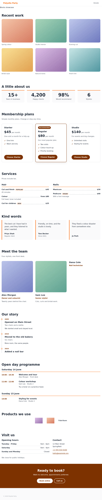

# Content blocks pack

Eleven extra blocks for the page builder, for the kinds of site people actually build with it: a
salon with a price list and opening hours, a restaurant menu, a portfolio or résumé, an event
programme, an agency, a knowledge base. Editors add them to a page like any other block, and the
public site draws them with a plain, accessible default that a theme can restyle or replace.

**Scope:** global. Install it once; every site's pages can then use the blocks. It adds no
collection and no field to any existing collection. The blocks keep their data in tables of their
own (`pages_blocks_<name>` and their version and language tables), created by the plugin's own
migration.

## The blocks

The block names (slugs) and field names are a contract: themes, demo content and imports rely on
them and they do not change. Fields are optional unless marked **required**. Text is translatable
(a language falls back to the site's default when empty); links, numbers, pictures and choices are
shared between languages. Pictures are relations to the media library, and the page builder's
description (alt text) of the picture is what is read aloud.

| Block (`blockType`) | Fields |
| --- | --- |
| `gallery` | `heading`; `images[]`: `image` (**required**, media), `caption`; `columns` (`"2"`, `"3"` or `"4"`, default `"3"`) |
| `pricing` | `heading`, `intro`; `plans[]`: `name` (**required**), `price` (**required**, text like `$45`), `period`, `description`, `features[]`: `text`, `buttonLabel`, `buttonHref`, `highlighted` (checkbox) |
| `testimonials` | `heading`; `items[]`: `quote` (**required**, textarea), `name` (**required**), `role`, `image` (media) |
| `timeline` | `heading`; `entries[]`: `period` (**required**), `title` (**required**), `subtitle`, `description` (textarea) |
| `team` | `heading`, `intro`; `members[]`: `name` (**required**), `role`, `bio` (textarea), `image` (media) |
| `cta` (call to action) | `heading` (**required**), `text`, `buttonLabel` (**required**), `buttonHref` (**required**), `secondaryLabel`, `secondaryHref` |
| `hours-contact` | `heading`; `hours[]`: `days` (**required**), `time` (**required**); `address` (textarea), `phone`, `email`, `note` |
| `price-list` | `heading`, `intro`; `sections[]`: `title` (**required**), `items[]`: `name` (**required**), `description`, `price`, `tag` (a small label such as "vegan" or "new") |
| `schedule` | `heading`; `days[]`: `label` (**required**), `sessions[]`: `time` (**required**), `title` (**required**), `speaker`, `room`, `description` |
| `stats` | `heading`; `items[]`: `value` (**required**), `label` (**required**) |
| `logos` | `heading`; `items[]`: `name` (**required**), `image` (media), `href` |

`price-list` serves salon services, restaurant menus and shop catalogues alike: groups of items with
a name, an optional description and price, and an optional tag.

## What visitors get

One plain component per block, with semantic markup:

- a block's `heading` is an `h2`; the headings below it (a plan, a person, a group of prices, a day) are one level
  down, or `h2` when the block has no heading of its own, so the page's outline never skips a level;
- lists are lists (`ul`, `ol`), figures have captions, the timeline and schedule are ordered lists, key figures and
  opening hours are description lists, contact details sit in `address`, and times are `<time>` elements when they
  are clearly times ("9am - 5pm", "09:30");
- buttons are links; every picture has an `alt` (the media's own description, falling back to the caption or name,
  or empty when the name is written beside it);
- the recommended pricing plan is marked in words ("Recommended"), not by colour alone;
- focus is visible, text meets AA contrast, and layouts are responsive;
- nothing is requested from another website: no fonts, scripts or maps, and no inline event handlers.

Block data is not trusted. Text is drawn as text, never as HTML. A link is followed only if it is `http`, `https`,
`mailto`, `tel` or a page of the site (`/contact`, `#top`); anything else (`javascript:`, `data:`, `//other.site`) is
dropped, and a button without a usable address is left out. A picture address must be `http`, `https` or relative.
A row of bad data is skipped rather than breaking the page, and a block with nothing to show draws nothing.

The fixed words ("Recommended", "Opening hours", "Contact", "Speaker", "Room", ...) come with French, Spanish and
German dictionaries and follow the visitor's language like the rest of the site; internal links get the language
prefix.

## Restyling and replacing

**Restyle with CSS.** Every block is `<section class="poly-block poly-block--<name>">` with an inner
`poly-block__inner`, and its parts carry `poly-<name>__<part>` classes: `poly-pricing__item`,
`poly-pricing__item--highlighted`, `poly-gallery__image`, `poly-team__name`, `poly-schedule__time`,
`poly-stats__value`, and so on (read the component for the full list). The default styles live in the `components`
cascade layer, so any ordinary rule in a theme, and any Tailwind utility, wins without a specificity fight. To
recolour everything at once set variables on `:root` (or on one block):

| Variable | Meaning | Default |
| --- | --- | --- |
| `--poly-accent` | The site's colour (falls back to `--color-primary`, then `--brand-primary`) | blue |
| `--poly-text`, `--poly-muted` | Text and secondary text | dark grey |
| `--poly-surface`, `--poly-border` | Panels and lines | light grey |
| `--poly-radius`, `--poly-gap` | Corner radius and grid gap | `0.75rem`, `1.5rem` |

Text is never drawn in the accent itself: links, buttons and labels use the accent mixed half with black, which keeps
them readable on white for any normal brand colour.

**Replace a block in a theme.** Ship a component with the block's name in the theme's own folder, exactly as for the
core's blocks: `themes/polysite-theme-<name>/components/<name>/GalleryBlock.vue` becomes that theme's gallery. A child
theme inherits its parent's. The component receives the block's fields as props (and `id`, `blockType`, `blockName`).
Names: `GalleryBlock`, `PricingBlock`, `TestimonialsBlock`, `TimelineBlock`, `TeamBlock`, `CtaBlock`,
`HoursContactBlock`, `PriceListBlock`, `ScheduleBlock`, `StatsBlock`, `LogosBlock`. The helpers in
`web/utils/blocks.js` (`safeHref`, `pictureOf`, `timeParts`, ...) can be copied into a theme.

## Needs

A core with the block-type registry (`$blockTypes`, `apps/web/utils/blockTypes.ts`), which lets a plugin's web part
register blocks with the page renderer. Without the plugin the core is exactly as before.

## Removing it

Taking the plugin away never deletes data. The tables stay; a page that holds one of these blocks keeps the data, and
the CMS and the public site simply no longer know the block. Put the plugin back and the blocks are as they were.
Generate any migration with the plugin present.

## Tests

```bash
docker exec polysite-cms-1 sh -c 'cd /repo/plugins/blocks-pack && node --test test/*.test.js'   # the config change and the link helpers
docker exec polysite-web-1 sh -c 'cd /repo/apps/web && npx vitest run blocks-pack'              # the web part's tables
docker exec polysite-cms-1 sh -c 'cd /repo/apps/cms && sh scripts/pluginMigrations.sh check blocks-pack'
```

`test/e2e/blocks.e2e.mjs` creates a published page with every block (hostile text and addresses included) through the
API and checks the HTML the public site renders. It runs with the other plugin checks in `tests/e2e/run-with-plugins.sh`
(`E2E_PLUGINS=blocks-pack E2E_PROJECT=polysite-e2e-blocks sh tests/e2e/run-with-plugins.sh` runs just this plugin).


